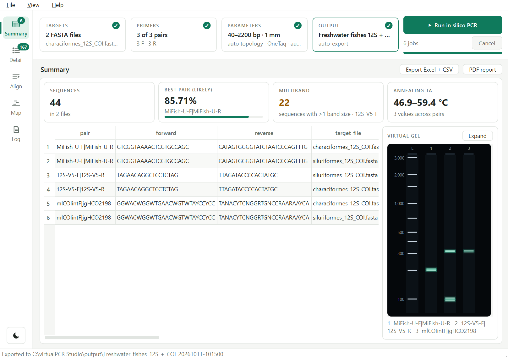
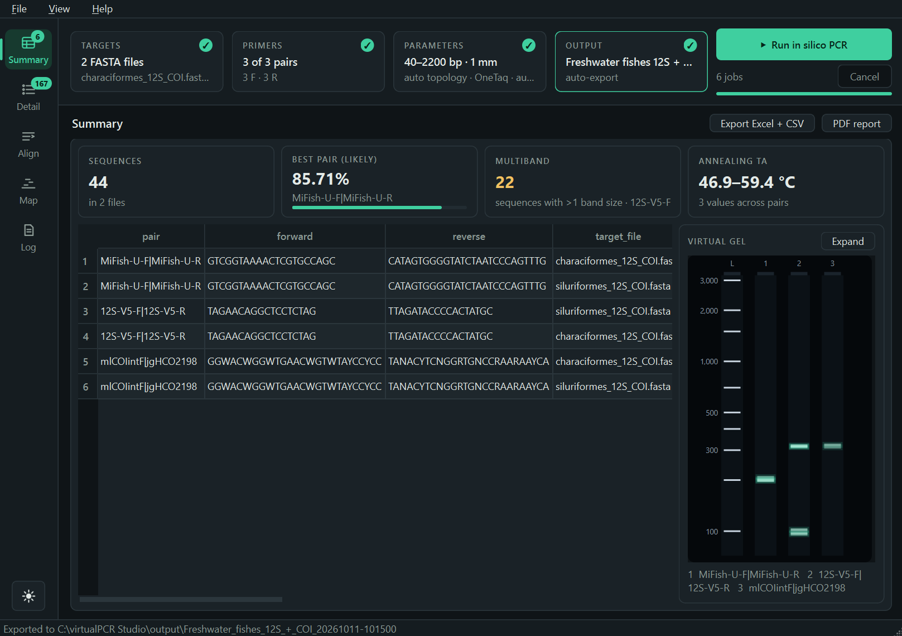

# virtualPCR Studio

A desktop GUI for **virtualPCR** by Ruslan Kalendar:
<https://github.com/rkalendar/virtualPCR>

PyQt6 front end and Python core around the `virtualPCR` JAR (Kalendar et al.
2024, GPLv3). It runs in silico PCR over one or more FASTA files with one or
more primer pairs, parses the report, scores every product biologically, and
exports tidy tables, a virtual gel and a PDF report. An independent built-in
engine can run beside the JAR as a second opinion, or instead of it where
there is no Java.

**Using the app:** download the Windows build from
[Releases](https://github.com/etovarluque/virtual-PCR-GUI/releases) — unzip and
run `virtualPCR Studio.exe`, no Python needed — and read the
**[user guide](docs/USER_GUIDE.md)** (also under *Help → User guide*). *Help →
About* shows the version (`vpcr.__version__`). This README is the technical
reference.





## Running it

Double-click **`Run vPCR.bat`**. It finds Python, installs the dependencies the
first time, and opens the window.

A console window opens and stays behind the app. Leave it there: it is where
Python reports anything the GUI cannot, and closing it closes the app.

It is one console, opened once. The `.bat` runs exactly one Python process — the
app — and finds the interpreter by searching `PATH` inside a `for` loop instead
of running `py --version`. `py.exe` is a launcher, so each such check would
start `py.exe` *and* `python.exe`, and each flashes its own window; an earlier
version ran five checks, which is where the flickering came from.

`vpcr/__main__.py` handles the rest:

* missing dependencies are detected and installed with `pip` into the same
  console;
* an uncaught exception is printed there, appended to `crash.log`, and shown in
  a dialog if the window is already up;
* `sys.stdout`/`sys.stderr` are replaced when absent, so `pythonw -m vpcr` also
  works if you ever want it windowless.

If Python is not on `PATH`, the `.bat` says so and waits.

```
vpcr_app/
  Run vPCR.bat        <- start here
  README.md
  requirements.txt
  jar/
    virtualPCR.jar    <- the engine; drop a different build here to swap it
  output/             <- exported results land wherever you choose
  vpcr/               <- the code
    __main__.py         `python -m vpcr` opens the GUI
    cli.py              `python -m vpcr.cli` runs it headless
    core/               no Qt: importable from scripts and notebooks
      model.py          dataclasses + config serialisation
      primers.py        loading primer pairs (FASTA / TSV / CSV / XLSX)
      runner.py         locating java, running the JAR, parallel batches
      parser.py         reading .out reports
      export.py         summary / detail tables, Excel + CSV
      scoring.py        biological score of each predicted amplicon
      thermo_engine.py  the built-in engine, independent of the JAR
      topology.py       circular or linear, decided per record for 'auto'
      jar_check.py      the JAR build's fingerprint and self-test
    gui/
      main_window.py    the application
      primer_dialog.py  the Manage primers window, and the primer state it edits
      primer_io.py      loading a primer file with the user in the loop
      column_dialog.py  manual column mapping for primer tables
      dnd.py            drag-and-drop file widgets, including the drop zone
      setup_strip.py    the setup tiles and the filter chips
      summary_view.py   the Summary view: headline cards and the virtual gel
      report.py         the PDF run report, with the gel
      nav_rail.py       the navigation rail down the left edge
      toast.py          toasts: notices in the corner of the results
      theme.py          light and dark themes, from one set of colour tokens
      widgets.py        spin boxes and combos that ignore the mouse wheel,
                        and the segmented control
```

## The window

A rail down the left edge chooses the view, setup runs across the top, and
results fill the rest:

```
┌──────┐┌ TARGETS ✓ ─────┐┌ PRIMERS ✓ ─────┐┌ PARAMETERS ✓ ───────┐┌ OUTPUT ✓ ─────┐ ▶ Run in silico PCR
│ ▦  4 ││ 2 FASTA files  ││ 7 of 10 pairs  ││ 90–2200 bp · 1 mm   ││ ensayo COI    │   14 jobs   Cancel
│Summ. ││ mito.fasta +1  ││ 6 F · 10 R     ││ circular · OneTaq ·…││ auto-export   │   ━━━━━━━━━━━━━━
│ ☰ 497│└────────────────┘└────────────────┘└─────────────────────┘└───────────────┘
│Detail│ Summary                                                         Export Excel + CSV
│ ≡    │ ┌ results of the chosen view ───────────────────────────────────────────────────┐
│Align │ │                                                                               │
│ ⊟    │ │                                              ┌ ✓ Exported to 12S_20261010… ✕ ┐ │
│Map   │ │                                              │   Open folder                 │ │
│ ▤  1 │ │                                              └───────────────────────────────┘ │
│Log   │ └───────────────────────────────────────────────────────────────────────────────┘
│  ☾   │
└──────┘
```

Each **tile** summarises its section and shows a ✓ once that section is ready
for a run: targets added, at least one pair ticked, a JAR found (or the built-in
engine chosen), an output folder a run can write to. Its tooltip holds the full
detail.

The output folder is **tested, not assumed**: a temporary file is created and
removed in it (on Windows, `os.access` ignores ACLs and share permissions), and
a folder that does not exist yet is judged by the nearest parent it would be
created in. A missing drive, a path that is a file, or a folder without write
permission turns the tile red with a "!" and the reason, also shown under the
*Folder* field. A run that writes (auto-export or raw .out reports) checks again
at *Run*, in case a network drive went away, and stops there with the reason
rather than failing at the end. The check waits 300 ms after typing stops, so it
does not touch the disk on every key.

**Click a tile** to open its form in the **drawer**, a sheet that drops from
the strip over the results; click the tile again, or another, to close or
switch. The results never move or change height whichever form is open: the
part the drawer leaves uncovered is dimmed, and a click there, **Esc**, or
**Run** closes it. Notices stay above the dimming. The drawer is as tall as the
open form, up to 70% of the window, always leaving a band of results in view;
past that it scrolls, with a visible scroll bar. *Reset to defaults* sits on
the title row of the *Run* column, so it is in view whatever the window height.
*Parameters* lays its form out in three columns: *Amplicon*, *Biological score*
and *Run* (which holds the JAR path). *View → … settings* opens a drawer from
the menu too.

**Drop files on the tiles.** FASTA files or a folder on *Targets*, a primer
file on *Primers*; the tile outlines in the accent colour for a usable file
and in red for one it cannot take. The drop zones inside the drawers still work.

**Run** sits at the end of the strip with the job count (pairs × files, doubled
when comparing engines), Cancel and the progress bar, always in view.

**The rail** lists the views: *Summary*, *Detail*, *Align* (Alignment), *Map*
(Primer map) and *Log*; Ctrl+1 … Ctrl+5 open them from the keyboard. Its badges
count what each holds after a run: pair/file rows on *Summary*, detail rows on
*Detail*, and, in red on *Log*, failed jobs or a failed run, until the Log is
opened. The view's name heads the results, with *Export* beside it, since it
writes every table. The Detail filters are chips on the Detail view.

**Notices are toasts**, not message boxes. They appear in the bottom-right
corner of the results, where they cover the end of a table rather than the
headline numbers, and they carry the next step as a button: *Open folder* after
an export, *Show log* when jobs fail, *View/Select primers* after a file loads.
Successes and information leave after five seconds, warnings after nine;
errors, and the warning about failed jobs, stay until closed so a partial
result is never missed. Hovering a toast holds it. Message boxes remain for
what needs an answer — quitting during a run — and inside the primer windows,
which are modal.

**Run checks the setup in strip order** and reports the first problem, opening
the form that fixes it:

1. *Targets* — at least one FASTA, and every listed file still on disk;
2. *Primers* — a file loaded, at least one pair ticked, no primer shorter than
   12 nt;
3. *Parameters* — min amplicon not above max, max not shorter than any pair's
   two primers together (no product could fit), and a JAR when a JAR engine is
   chosen;
4. *Output* — the folder can be written, when the run will write there.

**Summary at a glance.** Above the summary table, four cards: how many
sequences were searched (once per file, however many pairs), the best pair and
its share (*likely* products when scored), the pair with the most multiband
sequences, and either the agreement between engines or the annealing
temperatures used. Beside the table, a **virtual gel**: a ladder on a log scale
and one lane per pair — two, *J* and *B*, when both engines ran. Each product
size is a band as bright as the share of sequences that give it, so a size
nearly every species gives is a bright band, one a few give is faint, and
sizes that vary between species spread into a short smear. Hover a lane for
its numbers; click it to select its row. The gel stays dark in both themes, as
on a transilluminator.

**Expand** (or a double click on the gel) opens it in a window of its own,
which can be resized, maximised or moved to a second screen, and follows every
new run. It opens with the whole gel in view. **−** / **+**, Ctrl + wheel or
Ctrl +/− zoom it as an image viewer does — lanes, bands, ladder and labels
grow together, with scroll bars once it outgrows the window — and **Fit**
brings it back to the window's size. To pull apart bands a few bp apart, use
**Size range** instead: it shows only a window of sizes (say 85–200 bp),
so the variants separate into distinct bands, with finer ticks on the axis; and
**Copy** / **Save PNG…** take the gel into a report as it is shown.

**Light and dark.** The button at the foot of the rail switches theme;
*View → Theme* also offers *Follow Windows*, the default, which tracks the
Windows app setting live. Every colour comes from one set of tokens in
`gui/theme.py` — the Qt palette, the style sheet, the result-table highlights
and the Alignment HTML — so nothing is left light-on-light or dark-on-dark.

The window size and position and the theme are remembered between sessions, in
`QSettings` under `IAvH / virtualPCR Studio`. Closing the console that launched
the app kills the process without a `closeEvent`, so a resize schedules a save
400 ms later and flushes it with `sync()` rather than relying on a clean
shutdown. Minimum window size is 960 × 560: the rail, the strip and the three
Parameters columns all fit, with nothing clipped at the right edge.

The first window is 1082 × 764, or as much of it as the screen holds,
centred. A size saved by an earlier version is dropped once
(`ui/geometry_v`); a size the user sets afterwards is kept.

## Parameter defaults

*Parameters* carries **Reset to defaults**, disabled while nothing has changed.
It resets at once and offers **Undo** in a toast, rather than asking first. Its
tooltip lists the values it restores; the tile appends `modified` while any of
them differs. *3' mismatches* is a segmented control, 0 – 3: every choice in
view, one click, and nothing for a passing mouse wheel to change. (The CLI's
`--errors3` takes any value.)

The defaults live in one place, `PARAM_DEFAULTS` in `gui/main_window.py`, and
the widgets are built empty and filled from it — so the button cannot drift from
what the app starts with. The run parameters in it come from `STUDIO_DEFAULTS`
in `core/model.py`, which the CLI uses too, so the GUI and the CLI give the same
result for the same inputs:

| | |
|---|---|
| Min / max amplicon | 40 – 2200 bp |
| 3' mismatches | 1 |
| Template | auto (complete genomes circular, fragments linear) |
| Engine | virtualPCR JAR |
| Polymerase | OneTaq (NEB) |
| Annealing Ta | auto (per pair) |
| Extension | 60 s |
| Parallel jobs | auto: cores − 2, at most 8 |
| JVM heap | auto |
| Probe search | off |
| Extract amplicon sequences | on |
| Keep raw .out reports | off |

These suit barcoding and eDNA markers rather than the JAR's own defaults
(30–3000 bp, linear). Why each:

* **Min 40 bp.** Short markers — trnL P6, eDNA qPCR assays, teleo — fall below
  the 90 bp used before, and a pair whose products are all too short reads as
  *not amplifying*, with no warning. No real product is shorter than its two
  primers, so a low floor loses nothing.
* **Template auto.** A circular search joins a sequence's end to its start.
  Right for a complete mitogenome; wrong for a gene fragment from GenBank or
  BOLD, where it can produce a product made of the last and the first bases,
  which exists in no tube. *Auto* decides per record (`core/topology.py`):
  *partial* or a numbered eukaryotic chromosome → linear; *complete genome /
  sequence*, *mitogenome*, *plastome* → circular; otherwise a mitogenome's
  length (14–20 kb) → circular, so custom headers still work; anything else →
  linear. *Circular* and *Linear* force one topology for every record (CLI:
  `--topology`, or `--circular` / `--linear`).
* **Engine: the JAR.** The published method, validated against products
  known by construction, on every machine. Without a suitable Java the tile
  turns red with a link to download it, rather than switching engines
  silently: *Auto* (still in the list) would run the built-in engine there, so
  the same inputs could give different results on two computers.
* **Extension 60 s.** See *Biological score*: a product too long for the
  extension time is scored down. 60 s covers ~1.2 kb with OneTaq.
* **Parallel jobs auto.** Every core but two, capped at 8 because each JAR job
  is a JVM with its own heap.

**The wheel does not change them.** Every spin box and the heap combo ignore
wheel events, so scrolling the panel past one no longer edits it — a silent way
to run with a parameter nobody chose. The wheel is ignored whether or not the
widget has focus: Qt gives focus to the first spin box as soon as the panel
appears, and clicking a field to type in it leaves it focused, so a focus test
would let the accident back in. An ignored wheel event propagates to the parent,
which is why the panel scrolls as though the widgets were not there. Use the
keyboard or the arrows to set them.

## Requirements

* Python 3.10+, `PyQt6`, `pandas`, `openpyxl`, `primer3-py` (`Run vPCR.bat` installs these)
* A JRE. **Check which one:** the JAR in `jar/` (upstream build of
  2026-08-27) is compiled for Java 26 and will not start on Java 25; the
  2026-07-08 build needed Java 25. *Help → Java / JAR info* reports both the
  JRE version and what the JAR needs.

## Building the Windows release

`python packaging/build.py` freezes the app with PyInstaller (`pip install
pyinstaller`) into `dist/virtualPCR Studio/` — `virtualPCR Studio.exe` with
`jar/`, `output/`, the licence, notice, README and `docs/` beside it — and zips
it as `dist/virtualPCR-Studio-<version>-win64.zip`. One folder rather than one
file, so the app starts without unpacking itself on every launch. Java is not
bundled. In the frozen app `jar/` and `output/` are looked for beside the
executable, no dependency is installed with pip, and Java probes run without a
console window.

## Installing on another computer

Copy the whole `vpcr_app` folder. Nothing else from this repository is needed.
On that machine, install Python 3.10+ and a JRE, then double-click
`Run vPCR.bat`.

`java -version` should print 26 or higher for the JAR in `jar/`. The app
searches for JREs on `PATH`, in the `PATH` and `JAVA_HOME` Windows records now
(so a JDK installed while the app is open counts), in the JDKs the installers
register under `JavaSoft`, and under the usual install folders (`Java`,
`Eclipse Adoptium`, `Microsoft`, `Zulu`, `Amazon Corretto`, `BellSoft`, `Semeru`
in `C:\Program Files`); it picks one new enough for the JAR. Java does not have
to be on `PATH`.
Free builds: [Eclipse Temurin](https://adoptium.net/temurin/releases/); any
release from the JAR's on works, so the app links to the page rather than to one
version.

Without a suitable Java, a JAR engine (*virtualPCR JAR* or *Both*) is flagged
as soon as the app opens: the *Parameters* tile turns red with the reason
("JAR needs Java 26+, none installed"), and the form says it again under
*Annealing Ta* with a link to download that Java. Choosing a JAR engine looks
for Java afresh — it may have been installed with the app open — and, if it
still cannot run, raises a toast with **Download Java** and **Use built-in
engine**; *Run* does the same. The built-in engine needs no Java.

No restart is needed after installing Java. While the JAR is waiting for one,
the app looks again in the background each time it comes back to the front —
from the installer, say — and when Java is there the tile turns green and a
toast says "Java 26 found — the JAR engine is ready".

The JAR always lives in `jar/virtualPCR.jar`, and the app takes it from there
at start, whether or not a Java to run it is installed — a missing or too old
Java is reported as such at *Run*. Only when `jar/` holds no JAR does the app
ask for one: at *Run*, with a file dialog, carrying on with the run once it is
chosen. The choice is remembered for the next session; *Browse* under
*Parameters → Run* changes it at any time, and `--jar` on the CLI.

## Usage

GUI — `Run vPCR.bat`, or:

```
python -m vpcr
```

CLI — same core, no window. `--jar` defaults to the one in `jar/`, and the
parameters default to the GUI's (40–2200 bp, 1 mismatch, auto topology, auto
engine, 60 s extension):

```
python -m vpcr.cli --primers primers.xlsx --sheet 12-16S \
                   --targets genomes.fasta --out results/
```

`--topology auto|circular|linear` (or `--circular` / `--linear`) sets the
template, `--engine jar|thermo|both|auto` the engine, `--extension SECONDS` the
extension time (0 leaves length out of the score). `--sheet` takes a worksheet name or a
0-based index (`--sheet 1` is the second sheet). If any job fails, the tables are
still written, the failures are listed in `run_log.txt`, and the exit status is 1.

The core carries no Qt import, so it can also be driven from a script:

```python
from vpcr.core.primers import load_pairs
from vpcr.core.runner import run_batch
from vpcr.core.export import write_tables

pairs = load_pairs("primers.xlsx", sheet="12-16S")
results = run_batch(pairs, ["genomes.fasta"], "jar/virtualPCR.jar")
write_tables("results/", results)
```

`run_batch` returns a list with three extra attributes: `errors` (one
`(pair, target, message)` per failed job), `cancelled`, and `complete`, which is
true only when every job ran and succeeded.

## Primer files

No general format exists; primer sheets are assay-specific. Four shapes load
directly:

| Shape | Layout |
|---|---|
| FASTA | records read two at a time: forward, reverse |
| TSV/CSV with header | any column order, detected by content; comma, tab or `;` (Excel in Spanish) |
| TSV/CSV without header | `name<TAB>forward<TAB>reverse` (the JAR's FRpairs format) |
| XLSX | any column order; pick the worksheet on load |

For tables the GUI always opens the column-mapping dialog with its guess
pre-filled, previews the resulting pairs, and lets you correct it. Sequence
columns are found by content; each primer's name is taken from the column
immediately to its left.

The dialog maps five columns: the pair name, and a name and a sequence for each
primer. It no longer offers a *second reverse*. The core still builds an extra
pair from one — `load_pairs` and the CLI do — but the detector claimed any third
DNA-looking column as that second reverse, and a wrong guess silently doubled
the pairs, which is a bad thing to discover after a run. Cross primers in
*View/Select primers* instead, where you can see what you are making.

A pair is named by joining both primer names with `|`, verbatim and without
shortening: `MiFish-U-F|MiFish-U-R`, `12Sa|12Sh`, `MacroB-F|MacroB-R2`. Nothing
is collapsed to a shared stem, so which primers were used is always visible and
two pairs sharing a stem stay distinct. When the table has a single label column
(`name | forward | reverse`), that label names the pair as given. The `|` is
kept in every table; it is replaced with `_` only when a pair name has to become
a filename.

## Recombining primers

The pairing in a primer file is the assay author's choice, not a property of
the oligos: the same forward is routinely tried against several reverses. So
loading a file fills three tables — **Forward**, **Reverse**, and the **Pairs to
run** the file suggests. A primer used by several pairs is listed once.

Those tables live in their own resizable window, **View/Select primers**, reached
from the button in the *Primers* drawer or from the *File* menu. A splitter
divides the oligos from
the pairs, and both the window size and that split are remembered between
sessions.

Tick any forwards and any reverses and press **Combine selected**: every ticked
forward is paired with every ticked reverse, and the result replaces the pairs
table. Beyond 12 pairs it asks first, since each pair is a separate JAR run over
every target sequence.

The pairs table stays editable — untick a combination, delete it, or type one in
by hand. Only ticked pairs run. **Use these pairs** applies the lot; *Cancel*
leaves the run configuration exactly as it was.

The *Primers* drawer keeps the summary — how many pairs are ticked, out of how
many, from how many oligos — the drop zone, and **Clear**, which forgets the loaded
file so another can be dropped in its place. It is what you need to see while
setting up a run; the tables are what you need while choosing primers, which is
a different task. The dialog carries no drop zone of its own: by the time it
opens, the file is loaded.

The CLI equivalent is `--combine`, which pairs every forward against every
reverse in the file.

## Drag and drop

Each field accepts only what it can use, and refuses the rest at the cursor:

* **Targets tile** and **Primers tile** — as the list and the zone below
* **JAR field** — a `.jar`
* **Target list** — FASTA files, or a folder (its `.fasta/.fa/.fas/.fna/.ffn/.frn`
  files are added; `.txt` only when dropped explicitly, so a folder drop does not
  sweep up primer files). Duplicates are skipped.
* **Primer drop zone** — a primer file, which loads the pairs as if opened via
  *Load file*.

The target list and the primer zone are the same drop target with different
words in it: one dashed outline, one palette (`zone_colors` in `dnd.py`), one
caption widget (`ZoneCaption`), three states. At rest each reads as an empty
field — base colour, dimmed caption — and says what it takes (`drag & drop ·
FASTA, TSV, CSV or XLSX`). They answer a drag before it is released: a usable
file turns them to the palette's highlight colour and they read *Release to
load*; the wrong kind of file turns them red and they read *Not a primer file*.
Clicking the primer zone opens the file dialog.

The caption is a real widget, not painted text, and both zones use the one
class. That is deliberate: on Windows a `QLabel` draws with ClearType while
`QPainter.drawText` falls back to grayscale antialiasing, so a hand-painted
caption looks visibly lighter and thinner beside a QLabel one — a difference
`.grab()` cannot show, because an offscreen pixmap has no subpixels to render
ClearType into. On the target list the caption is a child of the viewport,
centred, and shown only while the list is empty.

Answering a bad drag takes a small trick. Qt stops delivering `dragMove` and
`dragLeave` to a widget that ignored the `dragEnter`, and without them the zone
could neither paint itself red nor clean up when the drag left. So an unusable
drag *accepts the event* and refuses the *action*: `IgnoreAction` keeps the
cursor saying no, while the events keep arriving. A drag carrying no local file
at all is still ignored outright — it is not ours to comment on.

The zone repaints itself from the palette, so it works under a dark theme.
`setStyleSheet` re-polishes the widget and arrives back as a `PaletteChange`, so
the repaint is guarded twice — a re-entry flag, and a comparison against the
current sheet. Without both it recurses until the process dies, which it did.

## The two JAR generations are not interchangeable

Two builds exist, with different engines (`InSilicoPCR2`/`InSilicoPCR3` vs
`InSilicoPCR`) and different report formats. The parser reads both. **Their
results differ, and `number3errors` does not mean the same thing in each.**

Same primers (`L15411F`/`H15546R`), same 13,522 mitogenomes, `minlen=90`:

| Build | `number3errors` | Sequences amplified |
|---|---|---|
| old (Java 23) | 1 | 11,105 (82.1 %) |
| new (Java 25) | 1 | 6,851 (50.7 %) |
| new | 2 | 12,745 (94.3 %) |
| new | 3 | 12,765 (94.4 %) |

The old build accepted one *hard* mismatch on top of the degenerate ones; the
new build mostly does not. No setting of the new build reproduces the old
number. Which is right cannot be settled from the repository: the engine
(`InSilicoPCR`, `Melting`, `oligoparam`, `primer`) ships only as bytecode, so
`src/` cannot be rebuilt. **Pick one build, record which, and do not mix them
within a study.** Ask the author for the engine source — GPLv3 entitles you to it.

Prefer the new build: it fixes the two bugs below and does not crash on
circular templates. `Help → Java / JAR info` shows what is installed.

## Choosing the JAR build

The app ships the upstream build of **2026-08-27** (Java 26). It replaced the
2026-07-08 build (Java 25) after both were run, with the last build of the old
generation (2025-08-14, `InSilicoPCR2/3`, Java 24) and the built-in engine, on
216 linear templates whose products are known by construction: two pairs (one
exact, one degenerate), mismatches at 18 sets of positions counted from the
3' end, in the forward or the reverse site, three backgrounds each, plus two
products in one record, sites at the very ends and the minus strand.

| `number3errors` | old 2025-08-14 | 2026-07-08 | 2026-08-27 | built-in |
|---|---|---|---|---|
| 0 | 123 / 216 | 123 / 216 | 123 / 216 | 163 / 216 |
| 1 | 123 / 216 | 123 / 216 | 123 / 216 | 163 / 216 |
| 2 | 171 / 216 | 171 / 216 | 171 / 216 | 163 / 216 |

The three builds accept and reject the same sites, template by template, with
the same coordinates and sizes, all correct. In linear mode — the only one the
app uses — moving to 2026-08-27 changes no result. It does fix most of the
circular mode (below), and it is the build its author maintains. The cost is
Java 26.

Two things these templates do not settle. The 82 % vs 51 % gap in the table
above came from real mitogenomes and an old build for Java 23 that is no longer
in the upstream history; the old-generation build that is there behaves like
the new ones here, so the gap likely depends on mismatch patterns the synthetic
set does not cover. And every build accepts a single mismatch at the 3'
terminal base even with `number3errors=0`; the biological score is what marks
such a product down. The built-in engine follows duplex thermodynamics instead,
so it accepts some 5' mismatches the JAR refuses and refuses some the JAR
accepts — which is its purpose as a second opinion.

## Verifying the JAR build

The JAR states no version — its manifest names only the Java that compiled it —
and a different build can change the report format or the search without any
error, leaving the tables wrong in silence. So the app identifies a build by its
**SHA-256** and judges it by what it does (`core/jar_check.py`):

* **Known builds.** The builds checked as above are listed by name, from the
  bundled 2026-08-27 (Java 26, `96e9b06b…`) back to 2026-07-08 (Java 25,
  `44a010c0…`); any other is *unrecognised*.
* **Self-test.** Before a build is first used on a machine, it is run on
  templates whose products are known by construction — products on either
  strand, two in one record, sites at the very ends of a sequence, a record with
  none, three cases across the origin of a circle (a site cut by it, one at
  base 1), a circle shorter than the longest product, and a degenerate primer —
  and every product is compared with the truth: coordinates, size and sequence.
  It takes well under a second.
* **Once per build.** The verdict is kept per machine, in
  `%LOCALAPPDATA%\vpcr\verified_jars.json`, keyed by the SHA-256.

A build that **passes** is used, known or not: a toast says it was verified on
this machine. One that **fails** cannot be used by a JAR engine: the
*Parameters* tile turns red, a run stops with the failures listed
("lin_fwd: product 151-318 (167 bp), expected 151-318 (168 bp)"), and the
*Auto* engine falls back to the built-in one. *Help → Verify virtualPCR.jar*
runs the test again on demand; *Help → Java / JAR info* shows the build, its
SHA-256 and its verdict. The CLI does the same before a JAR run and exits 1 on
a failed build; `--skip-jar-check` overrides it.

## Biological score

The JAR answers *amplified or not* from mismatch counts. On top of that, every
predicted product gets a graded answer: **how many PCR cycles later than a
perfectly matched assay would it show up?** The score does not search for
sites; it grades the sites the JAR found, so the two layers stay comparable.

For each primer binding site:

* **Binding.** Nearest-neighbour free energy of the primer–template duplex at
  the annealing temperature, mismatches included (SantaLucia & Hicks 2004, via
  `primer3-py`), turned into the fraction of sites occupied by primer.
* **Degeneracy.** A primer with degeneracy *D* is *D* oligos at *C/D* each; only
  the variant matching the site binds it well. `L15411F` (×96) binds a perfect
  site at about two thirds the occupancy of a non-degenerate primer.
* **Extension.** A mismatch near the 3' end hinders the polymerase beyond its
  cost in binding, by position and type: purine·purine and C·C at the 3'
  terminus are the worst, T-containing ones mild (Kwok et al. 1990;
  Stadhouders et al. 2010). Past the fifth base only binding is affected.

* **Length.** A product longer than the polymerase copies in one cycle's
  extension (*Extension* in Parameters, CLI `--extension`; OneTaq and Taq
  ~1 kb/min, high-fidelity ~2 kb/min, plus ~10 s of ramp) is finished on only a
  share *e* of the strands each cycle. Unlike a mismatch, this costs in every
  cycle: the product grows (1 + *e*)-fold instead of 2-fold, which delays it by
  Cq·(ln 2 / ln(1 + *e*) − 1) cycles, with Cq = 25. A product 10 % too long
  loses ~2 cycles; twice too long, ~18 (unlikely). The share is reported as
  `length_delay` in `detail.csv`. Like the extension weights, it is a starting
  value for calibration.

The sites and the length combine into `delta_cq`, the estimated delay in
cycles, and a `call`: **strong** (≤ 2), **probable** (≤ 5), **weak** (≤ 10),
**unlikely**. Mismatches only matter in the first cycles; after that the primer
is part of the template.

**Polymerase.** *OneTaq (NEB)* is the default: a Taq + Deep Vent blend whose
3'→5' exonuclease can trim a 3' mismatch, so terminal mismatches cost it less
than Taq alone. *Taq* and *High-fidelity (Q5, Phusion)* are the other profiles.
Each sets the buffer used for the thermodynamics (OneTaq Standard buffer:
44 mM monovalent, 1.8 mM Mg²⁺, 0.2 µM primers).

**Annealing temperature, per pair.** Assays differ by marker, so each pair is
scored at its own Ta, in this order:

1. the pair's own Ta — a `Ta`, `Annealing` or `Anillamiento` column in the
   primer file, or the *Ta °C* column in *View/Select primers*;
2. *Annealing Ta* in Parameters, when set (CLI: `--ta`);
3. otherwise the lower primer Tm − 5 °C (+3 °C for high-fidelity), NEB's rule.

`summary.csv` records the polymerase, the Ta and where it came from, the count
per call and `pct_likely` (strong + probable). `detail.csv` adds per site
`dg`, `bound`, `ext3`, `efficiency` and `mismatch_detail` (`3'+0 C·A` = the
3'-terminal base, primer C facing template A). The Alignment tab shows the same.
The Detail chips filter on *Likely* and *Doubtful*. CLI: `--polymerase`, `--ta`,
and `--no-score` for the JAR's predictions alone.

**Read the calls as a ranking of risk, not as probabilities.** The
thermodynamics are standard, but the extension weights are literature-informed
starting values, not yet calibrated. Calibrating them against the lab's own
PCR outcomes (which primer pair amplified which species) is what will turn the
score into a prediction with a known error rate.

## Two engines

*Parameters → Engine* (CLI: `--engine`) chooses what predicts the products:

| Engine | What it is |
|---|---|
| **virtualPCR JAR** (default) | the upstream engine, scored as above |
| **Built-in (thermodynamic)** | an independent search in Python; needs no Java |
| **Both (compare)** | every pair through both, side by side |
| **Auto** | the JAR when a Java on this machine can run it, else built-in |

The built-in engine looks for sites the way a polymerase sees them, from the
3' end: two exact 7-nt seeds (the 3'-terminal seven bases, and the seven before
them), then the whole primer, IUPAC on both sides, up to 6 mismatches. Every
site is scored as in *Biological score*, and any top-strand site facing any
bottom-strand site within the size range is a product — the same primer on both
ends included, and across the origin of a circular template. Products are
reported down to *weak*; *unlikely* ones are left out, so *amplified* means
"expected to give a product". A site with mismatches in both seeds is not found;
it would hardly prime anyway. It takes about 50 s per pair over 13,500
mitogenomes.

**Both** is the point of having two. Where they agree, a prediction rests on two
methods; where they do not, look closer. The run adds:

* `engine_comparison.csv` (and a sheet in the workbook): one row per sequence
  and pair, what each engine predicted, sizes, the built-in call and delay,
  and `agreement` — `both`, `neither`, `jar only` or `thermo only`;
* an `engine` column in the tables, and `pct_engine_agreement` per pair;
* the *Engines disagree* chip on Detail; the Alignment tab labels each entry
  `[JAR]` or `[built-in]`.

Agreement is not proof: two engines can share a blind spot. Calibration
against lab results is still what makes either one trustworthy.

## Quirks the core compensates for

**Old build: amplicon sequences are one base short.** It reports a span of
`end - start + 1` but writes `end - start` bases, dropping the last base of the
reverse primer binding site. `parser.finalize` restores it from the target
FASTA; verified byte-for-byte against 11,117 amplicons. Pass `--no-repair` to
keep the output verbatim. `amplicon_size` is always the reported span. The new
build emits the full sequence. When a FASTA repeats a header, the base is taken
from the record whose sequence matches the amplicon, not from the first one.

**New build: the circular mode is not used.** Run against templates whose
products are known by construction, the JAR's linear mode is exact in every
build since 2026-07-08 — coordinates, sizes and sequences, on both strands and
with sites at the very ends — but `molecular=circle` in the 2026-07-08 build:

* reports every product a second time, at its size plus the template length
  minus one (a full turn of the circle, which no polymerase makes);
* gives a product across the origin no coordinates and no sequence, and a size
  one base short (137 for 138);
* places a site starting at base 1 at the template length plus one, or misses
  it;
* scores a site cut by the origin at a fraction of its identity (47 % for a
  perfect match).

The 2026-08-27 build fixes three of the four — no ghost products, products
across the origin with their coordinates and full size, a cut site at 100 % —
but still misses a reverse site starting at base 1:

| Case, `molecular=circle` | 2026-07-08 | 2026-08-27 |
|---|---|---|
| product across the origin | no coordinates, 1 bp short | correct |
| site cut by the origin | 47 % identity | 100 % |
| ghost product on a short circle | present | gone |
| reverse site at base 1 | missed | **still missed** |

So the runner never sets it, with any build. Each circular record is written with its first
bases appended — as many as the longest product needs — and searched as a
line; afterwards, sites and products found in the appended copy are dropped as
duplicates, ends past the origin are folded back (end < start, as in
`>16500-50`), and anything longer than the circle is discarded. Checked against
every case above: all correct, and in agreement with the built-in engine.

**Old build: crashes on some circular templates.** `molecular=circle` throws
`StringIndexOutOfBoundsException` in `InSilicoPCR2.FastStart` when a binding
site wraps past the end of the sequence. Use the new build for `--circular`.

**Both builds: sequences with no primer hit produce no output block.** They
would silently vanish from the results. The parser reconciles against the FASTA
headers and reports them as `amplified = False` (42 of the 13,522 above).

## Output

Every run goes into its own folder under the chosen output directory, named
after the primer pairs and the moment it finished:

```
output/
  L15411F-H15546R_20260709-150620/
    summary.csv
    detail.csv
    vpcr_results.xlsx
    report.pdf           <- the run on a few pages, with the virtual gel
    run_log.txt          <- parameters, primers, targets, timings, warnings
```

Two or three pairs are joined with `__`; beyond that the folder is named
`6-pairs_<timestamp>`, since the pairs are listed in `summary.csv` and in the
log anyway. `|` becomes `-` because Windows forbids it in paths. Runs never
overwrite each other: a name taken within the same second gets a `_2` suffix.

Fill in **Run label** (CLI: `--label`) to name the folder yourself. That is the
practical answer once you start combining primers, where the pair names get long
fast: `12S_cruzado_F_R_20260709-152709/` beats `6-pairs_20260709-152709/`.

*Export to Excel automatically* (on by default) writes that folder as soon as
the run finishes. Uncheck it to inspect the tables first and export by hand;
the *Export results* button does the same thing on demand, so pressing it twice
gives two folders rather than clobbering one.

**Partial runs are marked as such.** If a job fails, the other pairs still run;
the failures are listed in a warning, in the log and in `run_log.txt`, because
their pairs are missing from the tables. **Cancel** drops the queued jobs and
stops the JAR processes that are running, so it takes effect within a second.
A cancelled run is not auto-exported; *Export results* still saves the jobs that
finished. Closing the window during a run asks first, then stops it.

**PDF report.** Every export also writes `report.pdf` (US Letter), and the
*PDF report* button beside *Export* (or *File → Save PDF report…*) saves one
wherever you choose. It is meant to be filed or shared without the app:

* the headline numbers of the Summary tab;
* the **virtual gel** at print resolution, with a key giving each lane's pair,
  the share of sequences that amplify and its main sizes (beside the gel when
  it is narrow, across the page when many pairs widen it). A lane is a primer
  pair, not a sample: every sequence of the run shows in that lane, as band
  brightness. With more than 20 lanes — many pairs, or both engines — the gel
  moves to the end of the report, after the tables, cast as several gels of
  up to 20 lanes with their own ladder, all at one scale and numbered on
  from one to the next;
* the result per pair: sequences, amplified, likely, sequences with more than
  one band size, size median and range, Ta, and the engines' agreement when
  both ran;
* the primers, 5'→3';
* the run setup as it was when *Run* was pressed — targets, engine, the JAR
  build with its SHA-256 and self-test verdict, Java, every parameter — so a
  parameter changed afterwards does not leak in;
* a warning at the top when the run was cancelled or jobs failed, and a note
  when circular templates went through the JAR's linear mode.

It is laid out by Qt (`gui/report.py`), so it needs no extra package. The full
tables stay in the CSV and Excel files.

If the workbook is still open in Excel the write fails with a permission error,
and the app says so instead of failing silently.

The CLI writes straight into `--out`; pass `--subfolder` for the same
`<primers>_<timestamp>` layout.

`summary.csv` — one row per (pair, target file): sequences, amplified count and
percentage, `n_multi_amplicon`, `n_multiband`, size range, median Ta.

`detail.csv` — one row per predicted amplicon, plus one row per sequence that
produced none. Carries per-primer identity, Tm, mismatch counts and
`min_3prime_dist`: the distance from the primer's 3' end to its nearest
mismatch. A mismatch 15 nt from the 3' end is harmless; one at the penultimate
base usually kills amplification.

## Sequences with more than one amplicon

Two different questions, two columns. A sequence can yield several products
that happen to share a length; on a gel those run as a single band.

* `n_amplicons` — predicted products for this sequence. `> 1` means the primers
  bind at several loci.
* `n_unique_sizes` — how many *distinct* lengths those products have. `> 1` is
  what a gel resolves as multiple bands.

In `detail.csv` each amplicon is its own row, so a sequence with three products
appears three times; filter on either column. `summary.csv` aggregates them as
`n_multi_amplicon` and `n_multiband`.

The chips on the Detail tab filter the table in place: *All*, *Amplified*,
*Not amplified*, *Multi-product*, *Multiband*, and from the biological score
*Likely* and *Doubtful*, plus *Engines disagree* when comparing engines.

Across 13,522 mitogenomes with `L15411F|H15546R`, 33 sequences gave more than
one product but only 3 gave more than one size. Two duplicated
`Heteronotia_binoei` mitogenomes yield the same 176 bp product at two loci — one
band. `Phalacrocorax_aristotelis` yields 176, 173 and 1945 bp: the long one is
the forward site of one copy paired with the reverse site of the other, and it
would show as a real extra band.

The FASTA header is carried verbatim. Splitting it into accession / species /
group is assay-specific, so it is opt-in: `--header-fields accession,species,...`
