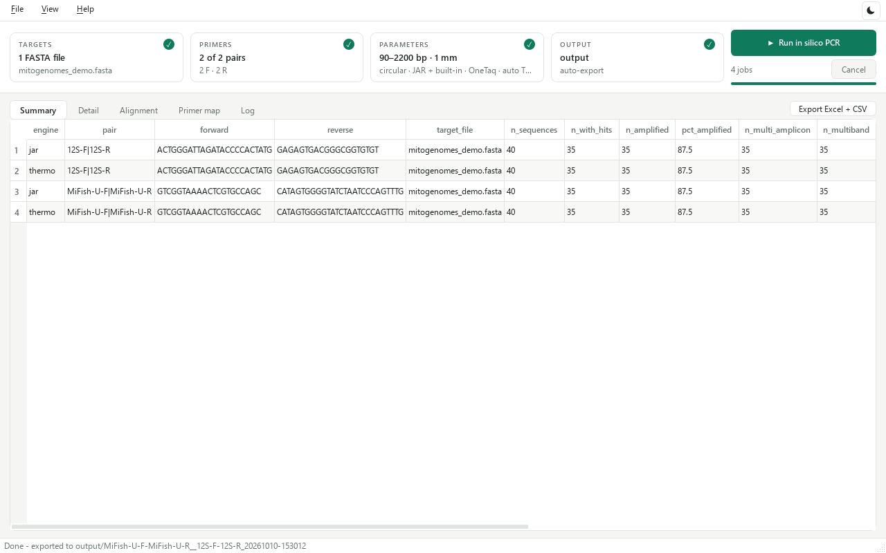
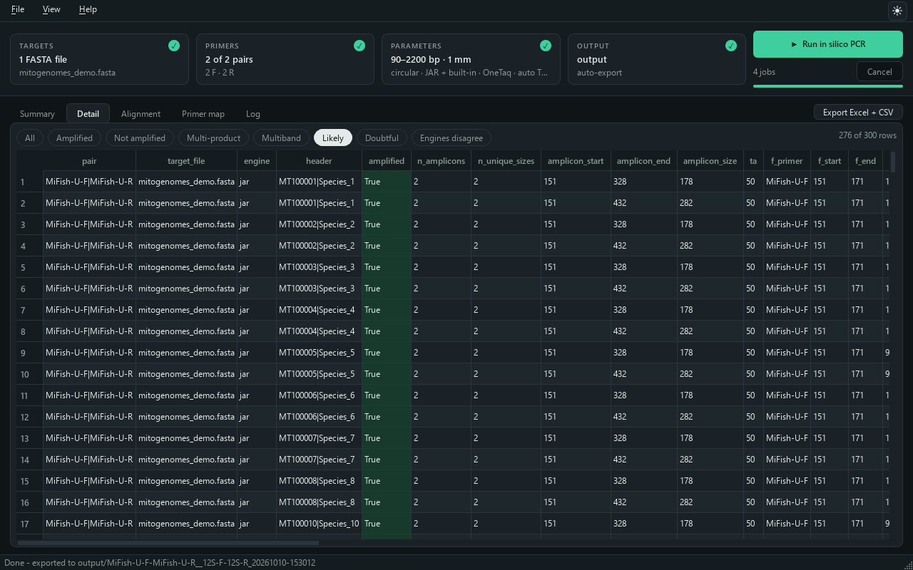

# virtualPCR Studio

A desktop GUI for **virtualPCR** by Ruslan Kalendar:
<https://github.com/rkalendar/virtualPCR>

PyQt6 front end and Python core around the `virtualPCR` JAR (Kalendar et al.
2024, GPLv3). It runs in silico PCR over one or more FASTA files with one or
more primer pairs, parses the report, and exports tidy tables.

The JAR is the engine; nothing here reimplements primer binding or the
thermodynamic model. All of the in silico PCR logic lives in the upstream
project linked above.





## Running it

Double-click **`Run vPCR.bat`**. It finds Python, installs the dependencies the
first time, and opens the window.

A console window opens and stays behind the app. Leave it there: it is where
Python reports anything the GUI cannot, and closing it closes the app.

It is one console, opened once. The `.bat` runs exactly one Python process — the
app — and finds the interpreter by searching `PATH` inside a `for` loop instead
of running `py --version`. `py.exe` is a launcher, so each such check would
start `py.exe` *and* `python.exe`, and each flashes its own window; an earlier
version ran five checks, which is where the flickering came from.

`vpcr/__main__.py` handles the rest:

* missing dependencies are detected and installed with `pip` into the same
  console;
* an uncaught exception is printed there, appended to `crash.log`, and shown in
  a dialog if the window is already up;
* `sys.stdout`/`sys.stderr` are replaced when absent, so `pythonw -m vpcr` also
  works if you ever want it windowless.

If Python is not on `PATH`, the `.bat` says so and waits.

```
vpcr_app/
  Run vPCR.bat        <- start here
  README.md
  requirements.txt
  jar/
    virtualPCR.jar    <- the engine; drop a different build here to swap it
  output/             <- exported results land wherever you choose
  vpcr/               <- the code
    __main__.py         `python -m vpcr` opens the GUI
    cli.py              `python -m vpcr.cli` runs it headless
    core/               no Qt: importable from scripts and notebooks
      model.py          dataclasses + config serialisation
      primers.py        loading primer pairs (FASTA / TSV / CSV / XLSX)
      runner.py         locating java, running the JAR, parallel batches
      parser.py         reading .out reports
      export.py         summary / detail tables, Excel + CSV
      scoring.py        biological score of each predicted amplicon
      thermo_engine.py  the built-in engine, independent of the JAR
    gui/
      main_window.py    the application
      primer_dialog.py  the Manage primers window, and the primer state it edits
      primer_io.py      loading a primer file with the user in the loop
      column_dialog.py  manual column mapping for primer tables
      dnd.py            drag-and-drop file widgets, including the drop zone
      setup_strip.py    the setup tiles and the filter chips
      theme.py          light and dark themes, from one set of colour tokens
      widgets.py        spin boxes and combos that ignore the mouse wheel
```

## The window

Setup runs across the top, results fill the rest:

```
┌ TARGETS ✓ ──────┐┌ PRIMERS ✓ ─────┐┌ PARAMETERS ✓ ────────┐┌ OUTPUT ✓ ──────┐ ▶ Run in silico PCR
│ 2 FASTA files   ││ 7 of 10 pairs  ││ 90–2200 bp · 1 mm    ││ ensayo COI     │   14 jobs   Cancel
│ mito.fasta +1   ││ 6 F · 10 R     ││ circular · OneTaq ·… ││ auto-export    │   ━━━━━━━━━━━━━━
└─────────────────┘└────────────────┘└──────────────────────┘└────────────────┘
 Summary │ Detail │ Alignment │ Primer map │ Log                   Export Excel + CSV
```

Each **tile** summarises its section and shows a ✓ once that section is ready
for a run: targets added, at least one pair ticked, a JAR found (or the built-in
engine chosen), an output folder. Its tooltip holds the full detail.

**Click a tile** to open its form in the **drawer** under the strip; click it
again, or another tile, to close or switch. The drawer is as tall as the open
form and no taller, and the strip never grows, so the results keep the height.
*Parameters* lays its form out in three columns: *Amplicon*, *Biological score*
and *Run* (which holds the JAR path). *View → … settings* opens a drawer from
the menu too.

**Drop files on the tiles.** FASTA files or a folder on *Targets*, a primer
file on *Primers*; the tile outlines in the accent colour for a usable file
and in red for one it cannot take. The drop zones inside the drawers still work.

**Run** sits at the end of the strip with the job count (pairs × files, doubled
when comparing engines), Cancel and the progress bar, always in view.

The Detail filters are chips on the Detail tab; *Export* sits on the tab bar,
since it writes every table.

**Light and dark.** The button at the right of the menu bar switches theme;
*View → Theme* also offers *Follow Windows*, the default, which tracks the
Windows app setting live. Every colour comes from one set of tokens in
`gui/theme.py` — the Qt palette, the style sheet, the result-table highlights
and the Alignment HTML — so nothing is left light-on-light or dark-on-dark.

The window size and position and the theme are remembered between sessions, in
`QSettings` under `IAvH / virtualPCR Studio`. Closing the console that launched
the app kills the process without a `closeEvent`, so a resize schedules a save
400 ms later and flushes it with `sync()` rather than relying on a clean
shutdown. Minimum window size is 900 × 560.

## Parameter defaults

*Parameters* ends in **Reset to defaults**, disabled while nothing has changed
and asking for confirmation when something has. Its tooltip lists the values it
would restore; the tile appends `modified` while any of them differs.

The defaults live in one place, `PARAM_DEFAULTS` in `gui/main_window.py`, and
the widgets are built empty and filled from it — so the button cannot drift from
what the app starts with. The run parameters in it come from `STUDIO_DEFAULTS`
in `core/model.py`, which the CLI uses too, so the GUI and the CLI give the same
result for the same inputs:

| | |
|---|---|
| Min / max amplicon | 90 – 2200 bp |
| 3' mismatches | 1 |
| Parallel jobs | 4 |
| JVM heap | auto |
| Circular template | on |
| Probe search | off |
| Extract amplicon sequences | on |
| Keep raw .out reports | off |

These suit mitochondrial barcoding rather than the JAR's own defaults
(30–3000 bp, linear).

**The wheel does not change them.** Every spin box and the heap combo ignore
wheel events, so scrolling the panel past one no longer edits it — a silent way
to run with a parameter nobody chose. The wheel is ignored whether or not the
widget has focus: Qt gives focus to the first spin box as soon as the panel
appears, and clicking a field to type in it leaves it focused, so a focus test
would let the accident back in. An ignored wheel event propagates to the parent,
which is why the panel scrolls as though the widgets were not there. Use the
keyboard or the arrows to set them.

## Requirements

* Python 3.10+, `PyQt6`, `pandas`, `openpyxl`, `primer3-py` (`Run vPCR.bat` installs these)
* A JRE. **Check which one:** `dist/virtualPCR.jar` in the upstream repo is
  compiled for Java 25 and will not start on Java 24. The older
  `vPCR/virtualPCR.jar` targets Java 23. *Help → Java / JAR info* reports both
  the JRE version and what the JAR needs.

## Installing on another computer

Copy the whole `vpcr_app` folder. Nothing else from this repository is needed.
On that machine, install Python 3.10+ and a JRE, then double-click
`Run vPCR.bat`.

`java -version` should print 25 or higher for the JAR in `jar/`. The app
searches for JREs on `PATH`, under `C:\Program Files\Java` and
`C:\Program Files\Eclipse Adoptium`, and picks one new enough for the JAR. Java
does not have to be on `PATH`: a JDK in one of those folders is found anyway.

The JAR is looked for in `jar/`, next to the app, and one level up, so other
layouts work too as long as you point at it with *Browse* or `--jar`.

## Usage

GUI — `Run vPCR.bat`, or:

```
python -m vpcr
```

CLI — same core, no window. `--jar` defaults to the one in `jar/`, and the
parameters default to the GUI's (90–2200 bp, 1 mismatch, circular):

```
python -m vpcr.cli --primers primers.xlsx --sheet 12-16S \
                   --targets genomes.fasta \
                   --out results/ --circular --minlen 90 --maxlen 2200
```

Pass `--linear` for a linear template. `--sheet` takes a worksheet name or a
0-based index (`--sheet 1` is the second sheet). If any job fails, the tables are
still written, the failures are listed in `run_log.txt`, and the exit status is 1.

The core carries no Qt import, so it can also be driven from a script:

```python
from vpcr.core.primers import load_pairs
from vpcr.core.runner import run_batch
from vpcr.core.export import write_tables

pairs = load_pairs("primers.xlsx", sheet="12-16S")
results = run_batch(pairs, ["genomes.fasta"], "jar/virtualPCR.jar")
write_tables("results/", results)
```

`run_batch` returns a list with three extra attributes: `errors` (one
`(pair, target, message)` per failed job), `cancelled`, and `complete`, which is
true only when every job ran and succeeded.

## Primer files

No general format exists; primer sheets are assay-specific. Four shapes load
directly:

| Shape | Layout |
|---|---|
| FASTA | records read two at a time: forward, reverse |
| TSV/CSV with header | any column order, detected by content; comma, tab or `;` (Excel in Spanish) |
| TSV/CSV without header | `name<TAB>forward<TAB>reverse` (the JAR's FRpairs format) |
| XLSX | any column order; pick the worksheet on load |

For tables the GUI always opens the column-mapping dialog with its guess
pre-filled, previews the resulting pairs, and lets you correct it. Sequence
columns are found by content; each primer's name is taken from the column
immediately to its left.

The dialog maps five columns: the pair name, and a name and a sequence for each
primer. It no longer offers a *second reverse*. The core still builds an extra
pair from one — `load_pairs` and the CLI do — but the detector claimed any third
DNA-looking column as that second reverse, and a wrong guess silently doubled
the pairs, which is a bad thing to discover after a run. Cross primers in
*View/Select primers* instead, where you can see what you are making.

A pair is named by joining both primer names with `|`, verbatim and without
shortening: `MiFish-U-F|MiFish-U-R`, `12Sa|12Sh`, `MacroB-F|MacroB-R2`. Nothing
is collapsed to a shared stem, so which primers were used is always visible and
two pairs sharing a stem stay distinct. When the table has a single label column
(`name | forward | reverse`), that label names the pair as given. The `|` is
kept in every table; it is replaced with `_` only when a pair name has to become
a filename.

## Recombining primers

The pairing in a primer file is the assay author's choice, not a property of
the oligos: the same forward is routinely tried against several reverses. So
loading a file fills three tables — **Forward**, **Reverse**, and the **Pairs to
run** the file suggests. A primer used by several pairs is listed once.

Those tables live in their own resizable window, **View/Select primers**, reached
from the button in the *Primers* drawer or from the *File* menu. A splitter
divides the oligos from
the pairs, and both the window size and that split are remembered between
sessions.

Tick any forwards and any reverses and press **Combine selected**: every ticked
forward is paired with every ticked reverse, and the result replaces the pairs
table. Beyond 12 pairs it asks first, since each pair is a separate JAR run over
every target sequence.

The pairs table stays editable — untick a combination, delete it, or type one in
by hand. Only ticked pairs run. **Use these pairs** applies the lot; *Cancel*
leaves the run configuration exactly as it was.

The *Primers* drawer keeps the summary — how many pairs are ticked, out of how
many, from how many oligos — the drop zone, and **Clear**, which forgets the loaded
file so another can be dropped in its place. It is what you need to see while
setting up a run; the tables are what you need while choosing primers, which is
a different task. The dialog carries no drop zone of its own: by the time it
opens, the file is loaded.

The CLI equivalent is `--combine`, which pairs every forward against every
reverse in the file.

## Drag and drop

Each field accepts only what it can use, and refuses the rest at the cursor:

* **Targets tile** and **Primers tile** — as the list and the zone below
* **JAR field** — a `.jar`
* **Target list** — FASTA files, or a folder (its `.fasta/.fa/.fas/.fna/.ffn/.frn`
  files are added; `.txt` only when dropped explicitly, so a folder drop does not
  sweep up primer files). Duplicates are skipped.
* **Primer drop zone** — a primer file, which loads the pairs as if opened via
  *Load file*.

The target list and the primer zone are the same drop target with different
words in it: one dashed outline, one palette (`zone_colors` in `dnd.py`), one
caption widget (`ZoneCaption`), three states. At rest each reads as an empty
field — base colour, dimmed caption — and says what it takes (`drag & drop ·
FASTA, TSV, CSV or XLSX`). They answer a drag before it is released: a usable
file turns them to the palette's highlight colour and they read *Release to
load*; the wrong kind of file turns them red and they read *Not a primer file*.
Clicking the primer zone opens the file dialog.

The caption is a real widget, not painted text, and both zones use the one
class. That is deliberate: on Windows a `QLabel` draws with ClearType while
`QPainter.drawText` falls back to grayscale antialiasing, so a hand-painted
caption looks visibly lighter and thinner beside a QLabel one — a difference
`.grab()` cannot show, because an offscreen pixmap has no subpixels to render
ClearType into. On the target list the caption is a child of the viewport,
centred, and shown only while the list is empty.

Answering a bad drag takes a small trick. Qt stops delivering `dragMove` and
`dragLeave` to a widget that ignored the `dragEnter`, and without them the zone
could neither paint itself red nor clean up when the drag left. So an unusable
drag *accepts the event* and refuses the *action*: `IgnoreAction` keeps the
cursor saying no, while the events keep arriving. A drag carrying no local file
at all is still ignored outright — it is not ours to comment on.

The zone repaints itself from the palette, so it works under a dark theme.
`setStyleSheet` re-polishes the widget and arrives back as a `PaletteChange`, so
the repaint is guarded twice — a re-entry flag, and a comparison against the
current sheet. Without both it recurses until the process dies, which it did.

## The two JAR generations are not interchangeable

Two builds exist, with different engines (`InSilicoPCR2`/`InSilicoPCR3` vs
`InSilicoPCR`) and different report formats. The parser reads both. **Their
results differ, and `number3errors` does not mean the same thing in each.**

Same primers (`L15411F`/`H15546R`), same 13,522 mitogenomes, `minlen=90`:

| Build | `number3errors` | Sequences amplified |
|---|---|---|
| old (Java 23) | 1 | 11,105 (82.1 %) |
| new (Java 25) | 1 | 6,851 (50.7 %) |
| new | 2 | 12,745 (94.3 %) |
| new | 3 | 12,765 (94.4 %) |

The old build accepted one *hard* mismatch on top of the degenerate ones; the
new build mostly does not. No setting of the new build reproduces the old
number. Which is right cannot be settled from the repository: the engine
(`InSilicoPCR`, `Melting`, `oligoparam`, `primer`) ships only as bytecode, so
`src/` cannot be rebuilt. **Pick one build, record which, and do not mix them
within a study.** Ask the author for the engine source — GPLv3 entitles you to it.

Prefer the new build: it fixes the two bugs below and does not crash on
circular templates. `Help → Java / JAR info` shows what is installed.

## Biological score

The JAR answers *amplified or not* from mismatch counts. On top of that, every
predicted product gets a graded answer: **how many PCR cycles later than a
perfectly matched assay would it show up?** The score does not search for
sites; it grades the sites the JAR found, so the two layers stay comparable.

For each primer binding site:

* **Binding.** Nearest-neighbour free energy of the primer–template duplex at
  the annealing temperature, mismatches included (SantaLucia & Hicks 2004, via
  `primer3-py`), turned into the fraction of sites occupied by primer.
* **Degeneracy.** A primer with degeneracy *D* is *D* oligos at *C/D* each; only
  the variant matching the site binds it well. `L15411F` (×96) binds a perfect
  site at about two thirds the occupancy of a non-degenerate primer.
* **Extension.** A mismatch near the 3' end hinders the polymerase beyond its
  cost in binding, by position and type: purine·purine and C·C at the 3'
  terminus are the worst, T-containing ones mild (Kwok et al. 1990;
  Stadhouders et al. 2010). Past the fifth base only binding is affected.

The two sites combine into `delta_cq`, the estimated delay in cycles, and a
`call`: **strong** (≤ 2), **probable** (≤ 5), **weak** (≤ 10), **unlikely**.
Mismatches only matter in the first cycles; after that the primer is part of
the template.

**Polymerase.** *OneTaq (NEB)* is the default: a Taq + Deep Vent blend whose
3'→5' exonuclease can trim a 3' mismatch, so terminal mismatches cost it less
than Taq alone. *Taq* and *High-fidelity (Q5, Phusion)* are the other profiles.
Each sets the buffer used for the thermodynamics (OneTaq Standard buffer:
44 mM monovalent, 1.8 mM Mg²⁺, 0.2 µM primers).

**Annealing temperature, per pair.** Assays differ by marker, so each pair is
scored at its own Ta, in this order:

1. the pair's own Ta — a `Ta`, `Annealing` or `Anillamiento` column in the
   primer file, or the *Ta °C* column in *View/Select primers*;
2. *Annealing Ta* in Parameters, when set (CLI: `--ta`);
3. otherwise the lower primer Tm − 5 °C (+3 °C for high-fidelity), NEB's rule.

`summary.csv` records the polymerase, the Ta and where it came from, the count
per call and `pct_likely` (strong + probable). `detail.csv` adds per site
`dg`, `bound`, `ext3`, `efficiency` and `mismatch_detail` (`3'+0 C·A` = the
3'-terminal base, primer C facing template A). The Alignment tab shows the same.
The Detail chips filter on *Likely* and *Doubtful*. CLI: `--polymerase`, `--ta`,
and `--no-score` for the JAR's predictions alone.

**Read the calls as a ranking of risk, not as probabilities.** The
thermodynamics are standard, but the extension weights are literature-informed
starting values, not yet calibrated. Calibrating them against the lab's own
PCR outcomes (which primer pair amplified which species) is what will turn the
score into a prediction with a known error rate.

## Two engines

*Parameters → Engine* (CLI: `--engine`) chooses what predicts the products:

| Engine | What it is |
|---|---|
| **virtualPCR JAR** (default) | the upstream engine, scored as above |
| **Built-in (thermodynamic)** | an independent search in Python; needs no Java |
| **Both (compare)** | every pair through both, side by side |

The built-in engine looks for sites the way a polymerase sees them, from the
3' end: two exact 7-nt seeds (the 3'-terminal seven bases, and the seven before
them), then the whole primer, IUPAC on both sides, up to 6 mismatches. Every
site is scored as in *Biological score*, and any top-strand site facing any
bottom-strand site within the size range is a product — the same primer on both
ends included, and across the origin of a circular template. Products are
reported down to *weak*; *unlikely* ones are left out, so *amplified* means
"expected to give a product". A site with mismatches in both seeds is not found;
it would hardly prime anyway. It takes about 50 s per pair over 13,500
mitogenomes.

**Both** is the point of having two. Where they agree, a prediction rests on two
methods; where they do not, look closer. The run adds:

* `engine_comparison.csv` (and a sheet in the workbook): one row per sequence
  and pair, what each engine predicted, sizes, the built-in call and delay,
  and `agreement` — `both`, `neither`, `jar only` or `thermo only`;
* an `engine` column in the tables, and `pct_engine_agreement` per pair;
* the *Engines disagree* chip on Detail; the Alignment tab labels each entry
  `[JAR]` or `[built-in]`.

Agreement is not proof: two engines can share a blind spot. Calibration
against lab results is still what makes either one trustworthy.

## Quirks the core compensates for

**Old build: amplicon sequences are one base short.** It reports a span of
`end - start + 1` but writes `end - start` bases, dropping the last base of the
reverse primer binding site. `parser.finalize` restores it from the target
FASTA; verified byte-for-byte against 11,117 amplicons. Pass `--no-repair` to
keep the output verbatim. `amplicon_size` is always the reported span. The new
build emits the full sequence. When a FASTA repeats a header, the base is taken
from the record whose sequence matches the amplicon, not from the first one.

**Products crossing the origin of a circular template** are reported as
`>16500-50`, end before start. Their size is the one the report states
(`(120 bp)` in the new build); when the report gives none, it is computed from
the template length.

**Old build: crashes on some circular templates.** `molecular=circle` throws
`StringIndexOutOfBoundsException` in `InSilicoPCR2.FastStart` when a binding
site wraps past the end of the sequence. Use the new build for `--circular`.

**Both builds: sequences with no primer hit produce no output block.** They
would silently vanish from the results. The parser reconciles against the FASTA
headers and reports them as `amplified = False` (42 of the 13,522 above).

## Output

Every run goes into its own folder under the chosen output directory, named
after the primer pairs and the moment it finished:

```
output/
  L15411F-H15546R_20260709-150620/
    summary.csv
    detail.csv
    vpcr_results.xlsx
    run_log.txt          <- parameters, primers, targets, timings, warnings
```

Two or three pairs are joined with `__`; beyond that the folder is named
`6-pairs_<timestamp>`, since the pairs are listed in `summary.csv` and in the
log anyway. `|` becomes `-` because Windows forbids it in paths. Runs never
overwrite each other: a name taken within the same second gets a `_2` suffix.

Fill in **Run label** (CLI: `--label`) to name the folder yourself. That is the
practical answer once you start combining primers, where the pair names get long
fast: `12S_cruzado_F_R_20260709-152709/` beats `6-pairs_20260709-152709/`.

*Export to Excel automatically* (on by default) writes that folder as soon as
the run finishes. Uncheck it to inspect the tables first and export by hand;
the *Export results* button does the same thing on demand, so pressing it twice
gives two folders rather than clobbering one.

**Partial runs are marked as such.** If a job fails, the other pairs still run;
the failures are listed in a warning, in the log and in `run_log.txt`, because
their pairs are missing from the tables. **Cancel** drops the queued jobs and
stops the JAR processes that are running, so it takes effect within a second.
A cancelled run is not auto-exported; *Export results* still saves the jobs that
finished. Closing the window during a run asks first, then stops it.

If the workbook is still open in Excel the write fails with a permission error,
and the app says so instead of failing silently.

The CLI writes straight into `--out`; pass `--subfolder` for the same
`<primers>_<timestamp>` layout.

`summary.csv` — one row per (pair, target file): sequences, amplified count and
percentage, `n_multi_amplicon`, `n_multiband`, size range, median Ta.

`detail.csv` — one row per predicted amplicon, plus one row per sequence that
produced none. Carries per-primer identity, Tm, mismatch counts and
`min_3prime_dist`: the distance from the primer's 3' end to its nearest
mismatch. A mismatch 15 nt from the 3' end is harmless; one at the penultimate
base usually kills amplification.

## Sequences with more than one amplicon

Two different questions, two columns. A sequence can yield several products
that happen to share a length; on a gel those run as a single band.

* `n_amplicons` — predicted products for this sequence. `> 1` means the primers
  bind at several loci.
* `n_unique_sizes` — how many *distinct* lengths those products have. `> 1` is
  what a gel resolves as multiple bands.

In `detail.csv` each amplicon is its own row, so a sequence with three products
appears three times; filter on either column. `summary.csv` aggregates them as
`n_multi_amplicon` and `n_multiband`.

The chips on the Detail tab filter the table in place: *All*, *Amplified*,
*Not amplified*, *Multi-product*, *Multiband*, and from the biological score
*Likely* and *Doubtful*, plus *Engines disagree* when comparing engines.

Across 13,522 mitogenomes with `L15411F|H15546R`, 33 sequences gave more than
one product but only 3 gave more than one size. Two duplicated
`Heteronotia_binoei` mitogenomes yield the same 176 bp product at two loci — one
band. `Phalacrocorax_aristotelis` yields 176, 173 and 1945 bp: the long one is
the forward site of one copy paired with the reverse site of the other, and it
would show as a real extra band.

The FASTA header is carried verbatim. Splitting it into accession / species /
group is assay-specific, so it is opt-in: `--header-fields accession,species,...`
