# virtualPCR Studio — User guide

virtualPCR Studio predicts which sequences a primer pair amplifies, and at what
size, before you run a single tube. You give it FASTA files of target sequences
(mitogenomes, barcodes, gene fragments) and a list of primer pairs. It runs an
in silico PCR on every pair and every sequence and shows the result as tables
and a virtual agarose gel. Each run can be saved as Excel/CSV files and a PDF
report.

The search is done by **virtualPCR** by Ruslan Kalendar, bundled with the app.
The app also has a built-in engine of its own, and it scores every predicted
product on how well it would really amplify.

This guide covers version 1.0.1.

---

## Contents

1. [Installing](#1-installing)
2. [The window at a glance](#2-the-window-at-a-glance)
3. [Setting up a run](#3-setting-up-a-run)
4. [Running](#4-running)
5. [Reading the results](#5-reading-the-results)
6. [Saving results and the PDF report](#6-saving-results-and-the-pdf-report)
7. [The two engines](#7-the-two-engines)
8. [About the bundled virtualPCR.jar](#8-about-the-bundled-virtualpcrjar)
9. [Light and dark themes](#9-light-and-dark-themes)
10. [Troubleshooting](#10-troubleshooting)
11. [Citing and licence](#11-citing-and-licence)

---

## 1. Installing

1. Download `virtualPCR-Studio-1.0.1-win64.zip` from the
   [Releases page](https://github.com/etovarluque/virtual-PCR-GUI/releases).
2. Unzip it anywhere you can write to, for example `C:\virtualPCR Studio` or
   your Documents folder. Keep the folder together. `virtualPCR Studio.exe`
   looks for `jar\virtualPCR.jar` next to itself and saves results in `output\`
   by default.
3. Install **Java 26 or newer**, which the virtualPCR engine needs. Free builds:
   [Eclipse Temurin](https://adoptium.net/temurin/releases/). Java does not have
   to be on `PATH`, and you do not need to restart the app after installing it.
4. Double-click `virtualPCR Studio.exe`.

Python is not needed. Without Java, the app still works with its built-in
engine (see [section 7](#7-the-two-engines)).

> Windows may warn that the program is from an unknown publisher, because the
> exe is not code-signed. Choose *More info → Run anyway*.

---

## 2. The window at a glance

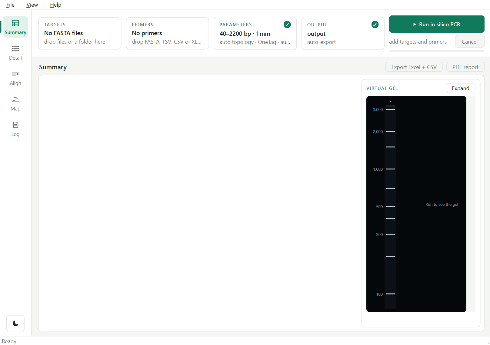

- **Setup strip (top).** Four cards — *Targets*, *Primers*, *Parameters* and
  *Output* — summarise the run. Click a card to open its form; click it again,
  or press **Esc**, to close it. A green ✓ means the card is ready; a red **!**
  means something there stops the run, with the reason on the card.
- **Run in silico PCR (top right)**, with the progress bar and **Cancel** below
  it.
- **Navigation rail (left).** The five result views: *Summary*, *Detail*,
  *Align*, *Map* and *Log* (shortcuts **Ctrl+1** to **Ctrl+5**). The badges
  give the number of rows in each table. The moon button at the bottom
  switches the theme.
- **Notices** appear in the bottom-right corner and close by themselves, apart
  from errors, which stay until you close them.

The window remembers its size and position. It opens at 1082 × 764 the first
time.

**Help → About virtualPCR Studio** shows the version you are running, the
virtualPCR.jar build in use, and the licence. **Help → User guide** opens this
guide.

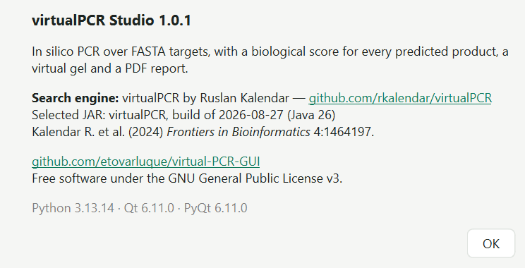

---

## 3. Setting up a run

### Targets

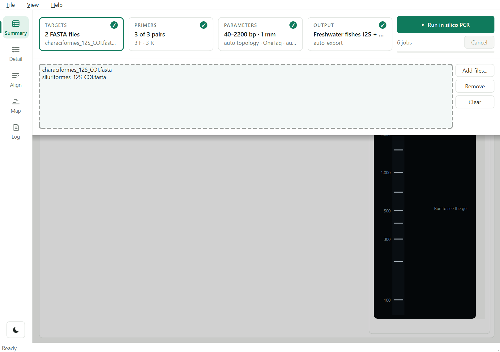

Drag FASTA files, or a whole folder, onto the list. You can also click
**Add files…**. A folder adds its `.fasta`, `.fa`, `.fas`, `.fna`, `.ffn` and
`.frn` files. The headers are kept exactly as they are and carried into every
table.

### Primers

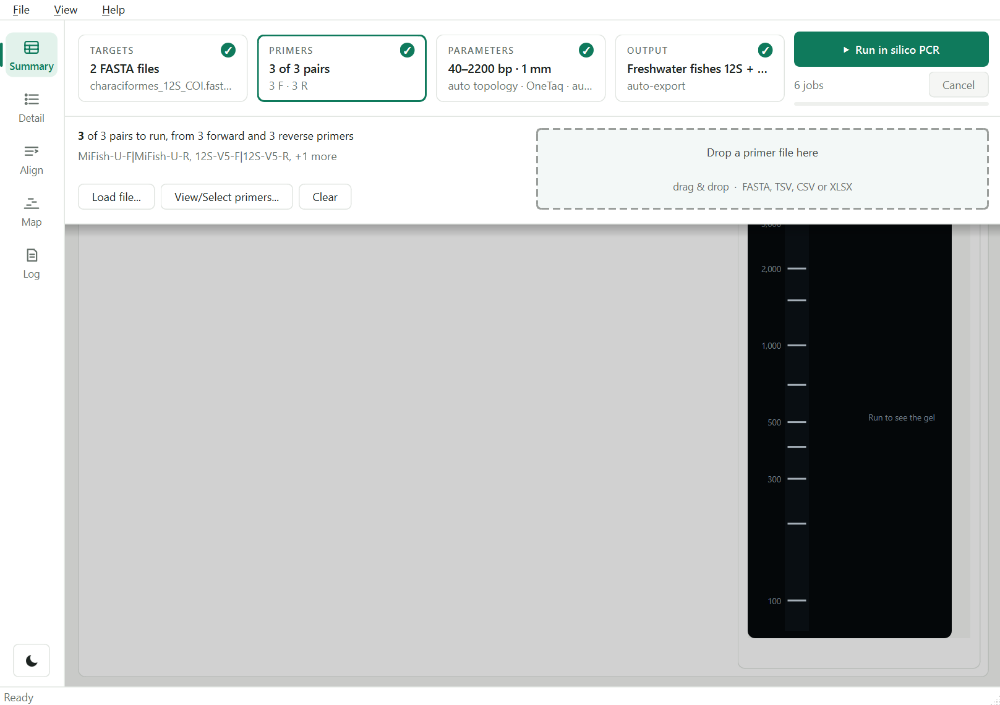

Drop a primer file onto the dashed zone, or click **Load file…**. Four layouts
are accepted:

| File | Layout |
|---|---|
| FASTA | records read two at a time: forward, then reverse |
| TSV / CSV with a header | any column order; the app proposes a mapping and lets you correct it |
| TSV / CSV without a header | `name`, `forward`, `reverse` |
| Excel (.xlsx) | any column order; choose the worksheet |

Degenerate bases (IUPAC: R, Y, W, S, K, M, B, D, H, V, N) are allowed. A pair
is named after both of its primers, e.g. `MiFish-U-F|MiFish-U-R`.

**View/Select primers…** opens the full tables:

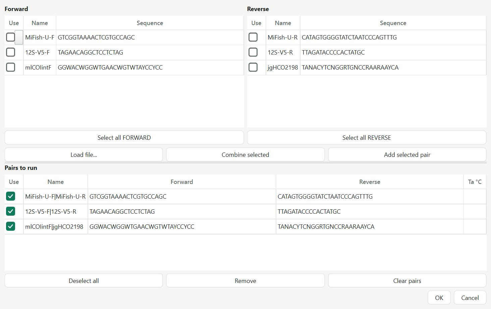

- Only ticked pairs run.
- To try a forward primer against other reverse primers, tick the forwards and
  reverses you want and press **Combine selected**. Every ticked forward is
  paired with every ticked reverse.
- **Add selected pair** adds a single combination; **Remove** and **Clear pairs**
  edit the list.
- A pair's own annealing temperature can be typed in the *Ta °C* column.

### Parameters

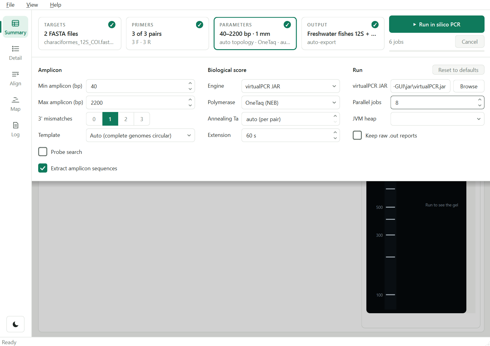

The defaults suit barcoding and eDNA markers:

| Setting | Default | What it does |
|---|---|---|
| Min / max amplicon | 40 – 2200 bp | Products outside this range are not reported. |
| 3′ mismatches | 1 | Mismatches the virtualPCR engine accepts near the primer's 3′ end (0–3). |
| Template | Auto | Decides for each sequence whether it is a circle or a line: complete genomes, mitogenomes and plastomes are circles; *partial* sequences and gene fragments are lines. *Circular* or *Linear* forces one for all. |
| Engine | virtualPCR JAR | See [section 7](#7-the-two-engines). |
| Polymerase | OneTaq (NEB) | Sets the buffer and the mismatch tolerance used by the biological score. |
| Annealing Ta | auto (per pair) | A pair's own Ta if it has one; otherwise lower primer Tm + the polymerase's offset. Set a value to use one Ta for every pair. |
| Extension | 60 s | Products too long to finish in this time are scored down. *off* leaves length out of the score. |
| Parallel jobs | cores − 2, at most 8 | How many runs go at once. |
| Probe search | off | virtualPCR's probe mode: looks for the binding sites of each oligo, including partial complementarity (TaqMan probes, gRNAs). Leave off for ordinary PCR. |
| Extract amplicon sequences | on | Keeps each product's sequence in the Detail table and exports. |

**Reset to defaults** restores the values in the table, and you can undo it
from the notice that appears.

The mouse wheel does not change these fields: scrolling over one moves the
form instead, so a value can never change by accident. Click a field and type,
or use its arrows.

### Output

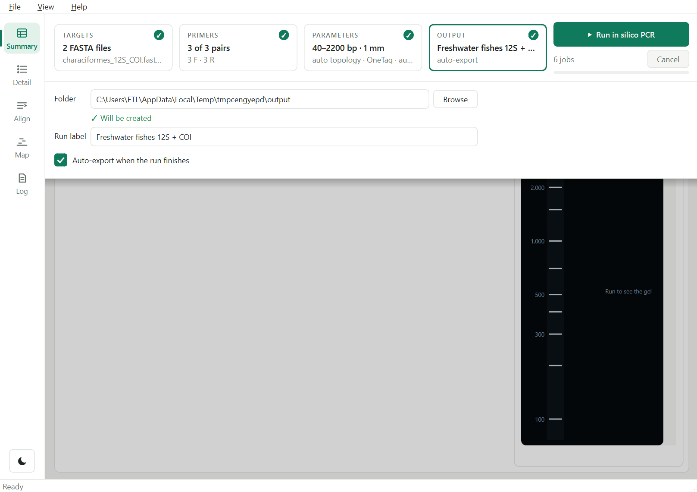

- **Folder** — where each run's results go. Under the field, a ✓ confirms the
  app has actually written a test file there; a ⚠ names the problem (a missing
  drive, a folder you may not write to).
- **Run label** — names the run's folder, e.g. `Freshwater_fishes_12S_+_COI_…`.
  Without it, the folder is named after the primer pairs.
- **Auto-export when the run finishes** — saves the tables and the PDF report
  as soon as the run ends.

---

## 4. Running

Press **Run in silico PCR**. Before starting, the app checks the setup in the
order of the cards: targets, then primers, then parameters (including the JAR
and Java), then the output folder. It stops at the first problem, opens the
card that fixes it and says what is wrong.

### When Java is missing

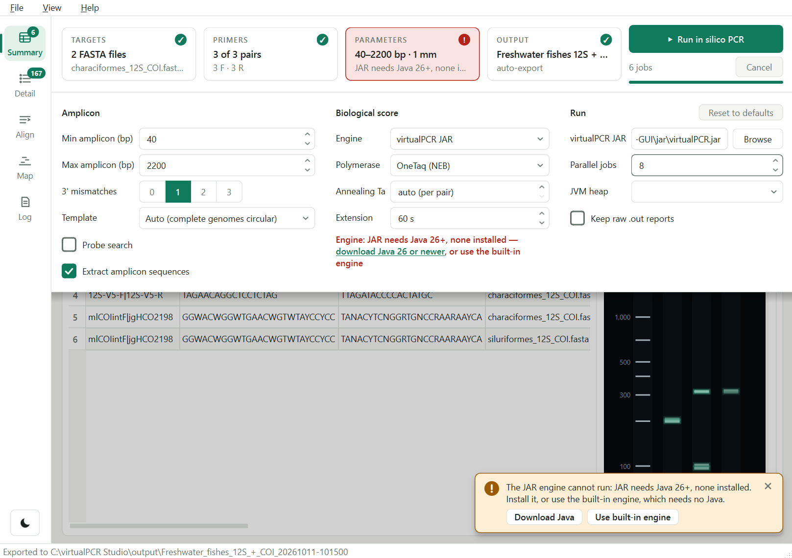

If the virtualPCR engine is chosen and no suitable Java is installed, the
*Parameters* card turns red as soon as the app opens. The form shows the reason
with a **download Java 26 or newer** link. Install Java and come back to the
app: it looks again and the card turns green, without a restart. Or press
**Use built-in engine**, which needs no Java.

The first time a virtualPCR.jar is used on a computer, the app runs a quick
self-test on it (well under a second). See
[section 8](#8-about-the-bundled-virtualpcrjar).

**Cancel** stops a run within a second. Pairs already finished are kept, but a
cancelled run is not exported automatically.

---

## 5. Reading the results

### Summary


- **Headline cards:** number of sequences; the best pair, by the share of
  sequences where a product is *likely*; the pair with the most *multiband*
  sequences (bands of more than one size); and the annealing temperatures used.
- **Table:** one row per pair and target file — sequences, amplified %,
  likely %, multiband counts, size range, Ta.
- **Virtual gel:** one **lane per primer pair**, beside a size ladder (log
  scale, like agarose). Every sequence of the run shows in its pair's lane: a
  band's **brightness** is the share of sequences giving that size. A size
  almost every species gives is a bright band; one a few give is faint; sizes
  that vary between species spread into a short smear. Hover a lane for its
  numbers; click it to select its row.

**Expand** (or a double click on the gel) opens it in its own window:

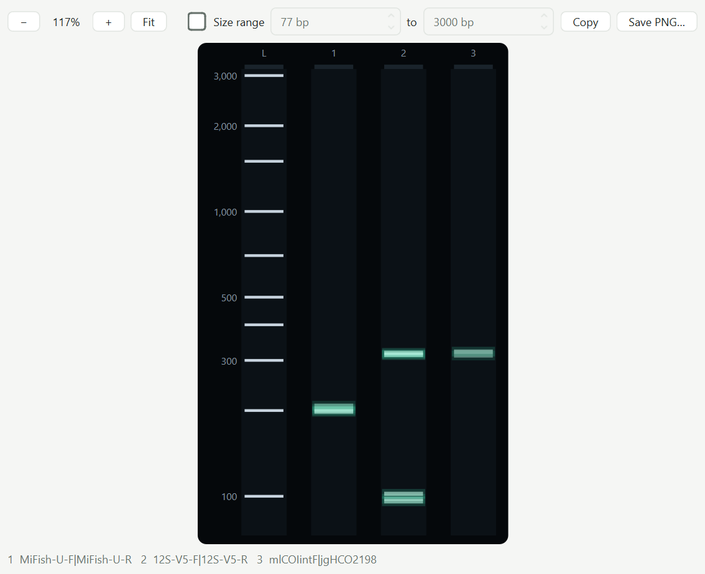

- **− / +**, Ctrl + mouse wheel or Ctrl +/− zoom the whole gel, labels included;
  scroll bars appear once it outgrows the window. **Fit** brings it back to the
  window's size.
- **Size range** shows only a window of sizes, so bands a few bp apart separate:

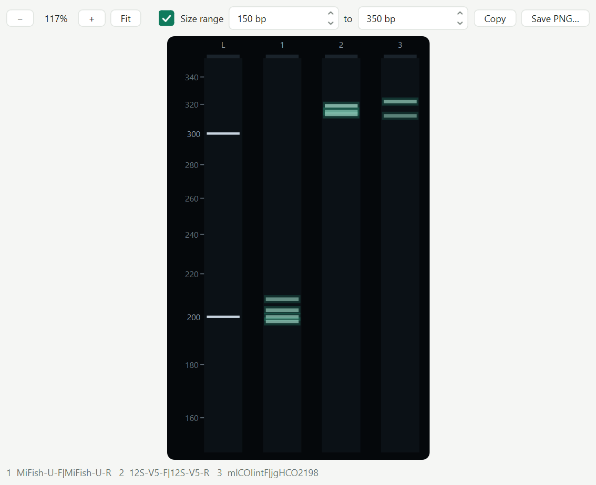

- **Copy** and **Save PNG…** take the gel as shown.

### Detail

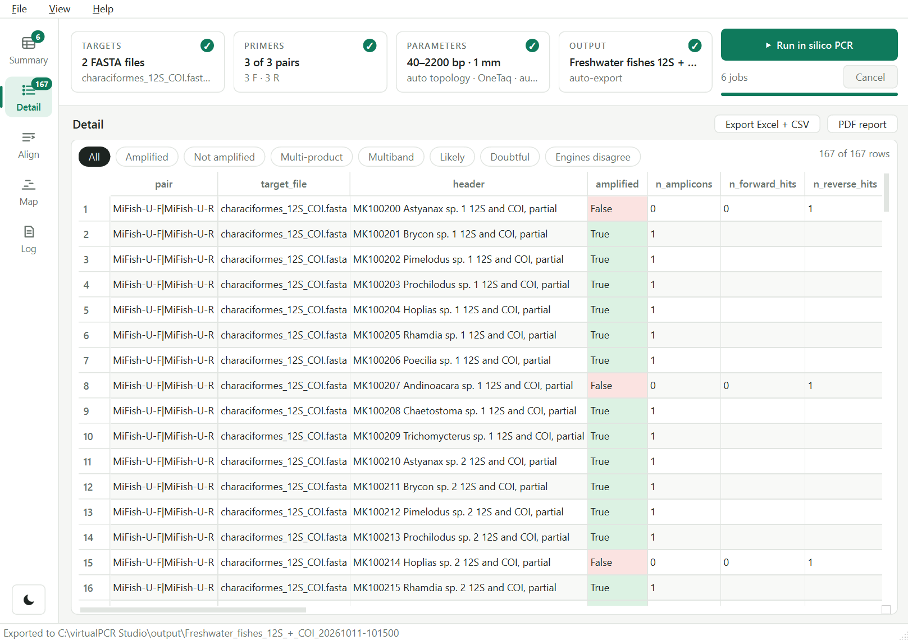

One row per predicted product, plus one per sequence that gave none. The chips
filter the rows: *Amplified*, *Not amplified*, *Multi-product* (more than one
product), *Multiband* (more than one size), *Likely*, *Doubtful*, and *Engines
disagree* when both engines ran.

The columns include each primer's identity, Tm and mismatches, and
`min_3prime_dist` — how far the nearest mismatch is from the primer's 3′ end. A
mismatch 15 nt from the 3′ end is harmless; one at the last or second-to-last
base usually stops amplification.

Each product also carries a **biological score**:

| Call | Meaning |
|---|---|
| strong | amplifies like a perfect match |
| probable | small delay; expect a product |
| weak | late, faint product possible |
| unlikely | not expected to amplify |

The score combines how well each primer binds at the annealing temperature
(duplex thermodynamics), how much its 3′ mismatches slow extension (for the
chosen polymerase), and whether the product is too long for the extension
time. It is expressed as the extra PCR cycles the product would need. It is a
model, not a measurement: calibrate it against your own gels.

### Alignment

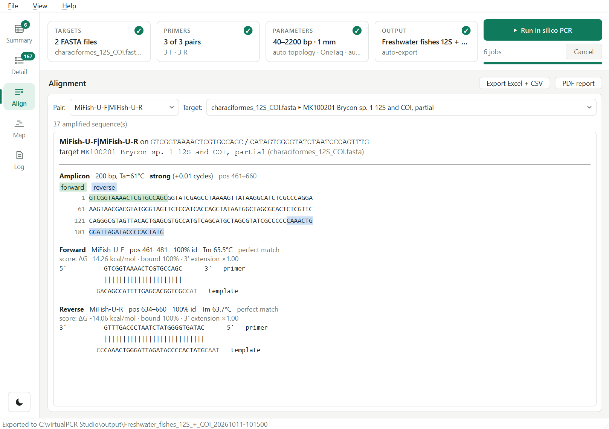

Choose a pair and an amplified sequence. The amplicon is shown with both
primer sites highlighted, and each primer drawn against its template: identity,
Tm, ΔG and the effect of each mismatch.

### Primer map

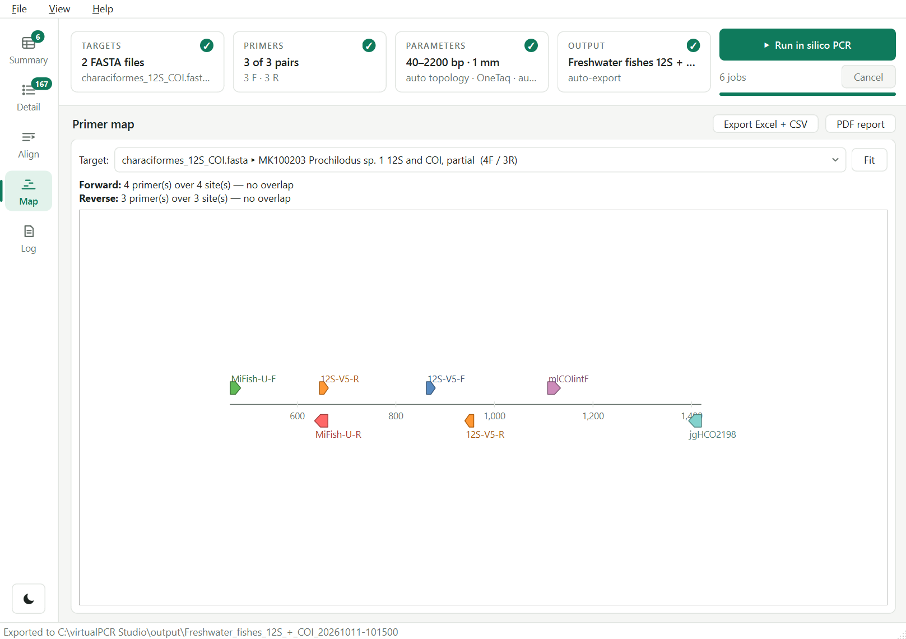

Every primer's binding sites on one sequence: forward primers above the line,
reverse primers below. It shows, for example, a reverse primer that also binds
inside another pair's product.

### Log

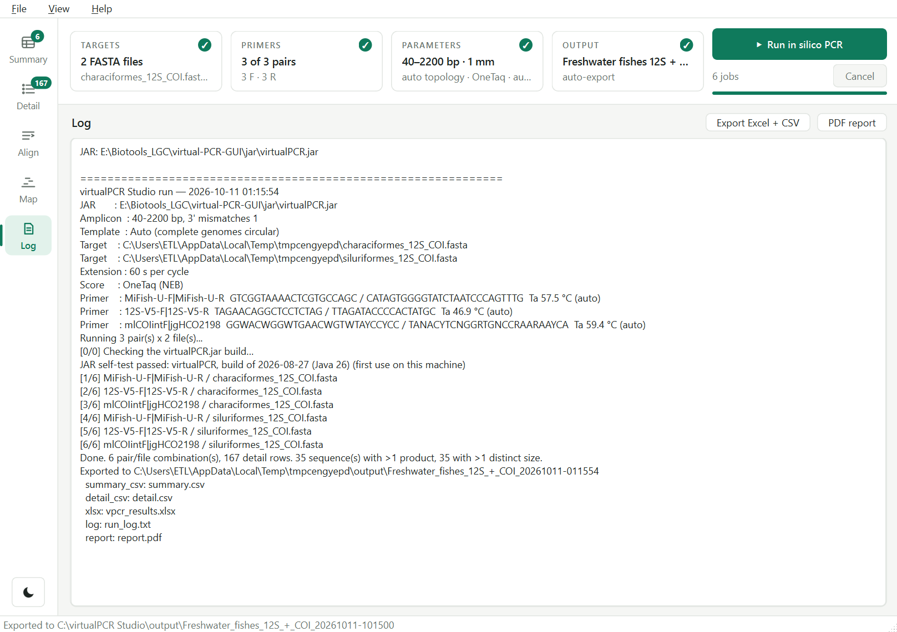

What each run did — parameters, files, engine, JAR build, timings, warnings.
It is saved with the results as `run_log.txt`.

---

## 6. Saving results and the PDF report

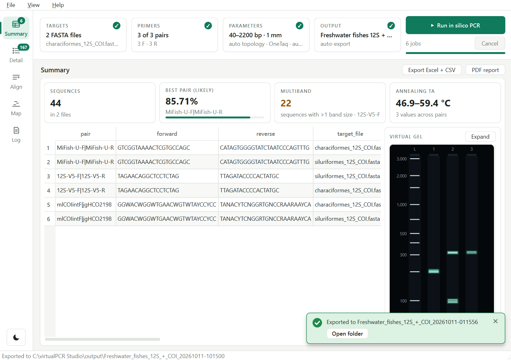

**Export Excel + CSV** (or auto-export) writes a folder for the run:

```
output\Freshwater_fishes_12S_+_COI_20261011-101500\
    summary.csv
    detail.csv
    vpcr_results.xlsx     (Summary, Detail and, with two engines, Engine comparison)
    report.pdf
    run_log.txt
```

Runs never overwrite each other. If Excel has the workbook open, the app says
so instead of failing silently. **PDF report** (or *File → Save PDF report…*)
saves the report anywhere you choose.

The **PDF report** (US Letter) is meant to be filed or shared:

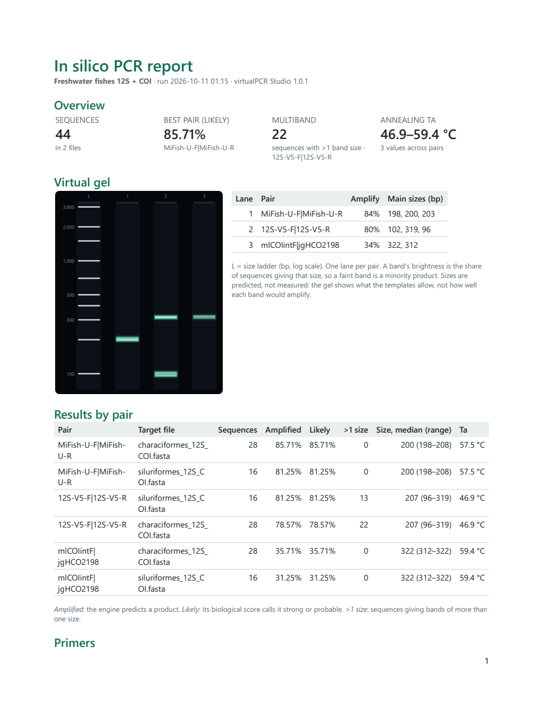

It holds the headline numbers, the virtual gel with a key to its lanes, the
results per pair, the primer sequences, and the run setup as it was when *Run*
was pressed: files, engine, the JAR build and its self-test result, Java, and
every parameter.

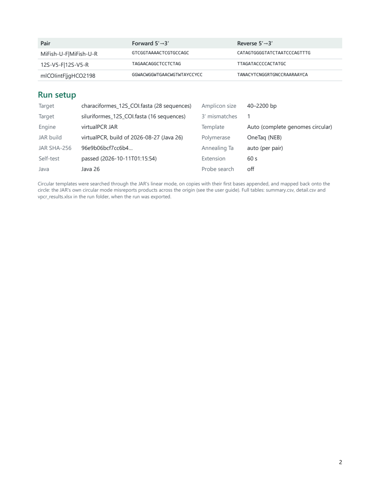

A cancelled run or failed jobs are flagged at the top. With more than 20 lanes,
the gel moves to the end of the report, split into gels of up to 20 lanes.

---

## 7. The two engines

*Parameters → Engine*:

| Engine | What it is |
|---|---|
| **virtualPCR JAR** (default) | The published virtualPCR program. Needs Java 26+. |
| **Built-in (thermodynamic)** | An independent search written for this app. Needs no Java. |
| **Both (compare)** | Every pair through both, side by side; *Engines disagree* in Detail lists where they differ. |
| **Auto** | The JAR when Java can run it, the built-in engine otherwise. Results then depend on the computer, so a fixed choice is better. |

The two engines decide differently. virtualPCR counts mismatches near the 3′
end. The built-in engine looks for sites the way a polymerase sees them, from
the 3′ end, and judges them by duplex thermodynamics. So the built-in engine
accepts some mismatches near the 5′ end that virtualPCR refuses, and refuses
some that virtualPCR accepts. Agreement between them is reassuring, but not
proof: lab results are what calibrate either one.

**Do not mix engines, or JAR builds, within one study.** The PDF report and
`run_log.txt` record which was used.

---

## 8. About the bundled virtualPCR.jar

The `jar\` folder holds **virtualPCR.jar from its author's repository**
([rkalendar/virtualPCR](https://github.com/rkalendar/virtualPCR)), the build
published on **2026-08-27**, unmodified (SHA-256 `96e9b06b…`, Java 26).

### Every build is checked

A JAR states no version, and a different build can change results without any
error. The app therefore identifies a build by its SHA-256 fingerprint. Before
a build is first used on a computer, the app runs it on sequences whose
products are known in advance: both strands, two products in one sequence,
sites at the very ends, a sequence with none, products across the origin of a
circle, and a degenerate primer. Every product must come back exactly. A build
that fails is not used. *Help → Verify virtualPCR.jar* repeats the test, and
*Help → Java / JAR info* shows the build, its fingerprint and the verdict.

### Why this build

Before bundling it, three builds and the built-in engine were run on 216
sequences whose products were known by construction. The sequences covered two
primer pairs (one exact, one degenerate), mismatches at 18 sets of positions
from the 3′ end of either primer, two products in one sequence, sites at the
ends, and the opposite strand. The table gives the number of sequences that
gave their product:

| 3′ mismatches setting | 2025-08-14 (older engine) | 2026-07-08 | 2026-08-27 (bundled) | Built-in engine |
|---|---|---|---|---|
| 0 | 123 / 216 | 123 / 216 | 123 / 216 | 163 / 216 |
| 1 | 123 / 216 | 123 / 216 | 123 / 216 | 163 / 216 |
| 2 | 171 / 216 | 171 / 216 | 171 / 216 | 163 / 216 |

The three builds gave **identical results**, sequence by sequence, with correct
coordinates and sizes. Moving to the 2026-08-27 build changes no result. It is
the build its author maintains, and it fixes most of the circular mode (below).

### Observations on the virtualPCR engine

These are worth knowing when you read its results:

1. **Its circular mode is not used.** The app searches circular templates
   (complete mitogenomes, plastomes) in virtualPCR's linear mode. It appends the
   first bases of each circle to its end, then maps the products back onto the
   circle. Run directly in circular mode, the engine gave these results on test
   sequences with known products:

   | Case, circular mode | 2026-07-08 build | 2026-08-27 build |
   |---|---|---|
   | product across the origin | no coordinates, size 1 bp short | correct |
   | primer site cut by the origin | 47 % identity for a perfect match | 100 % |
   | duplicate "ghost" product on a short circle | present | gone |
   | reverse primer site starting at base 1 | missed | **still missed** |

   The linear approach is correct in all four cases, with every build.

2. **A mismatch at the very 3′ end is accepted even with "3′ mismatches = 0".**
   Every build tested does this. The biological score is what marks such a
   product down, so check the *Likely* column and the `min_3prime_dist` column.

3. **Tm values reported by the JAR depend on the build.** The bundled build
   corrected its melting-temperature formula, so its Tm values are about
   0.6–0.9 °C lower than those of the 2026-07-08 build for the same sites. The
   sites, products and Ta are unchanged, and the biological score is not
   affected. Compare Tm columns only between runs of the same build.

4. **Builds of different generations have given different numbers on real
   data.** In an earlier comparison on 13,522 vertebrate mitogenomes with the
   `L15411F`/`H15546R` primers, an older build (Java 23) amplified 82 % of the
   sequences and the 2026-07-08 build 51 %. That older build is no longer in the
   author's repository, and the synthetic test above could not reproduce the
   gap. Record which build you used, and do not mix builds within a study.

5. **Source code.** The author publishes the source of the program's front end;
   the classes that perform the search are distributed only as compiled code.
   The source published for the bundled build is attached to each release of
   this app.

---

## 9. Light and dark themes


The moon button at the bottom of the rail switches between light and dark.
*View → Theme* also offers *Follow Windows*, the default, which follows the
Windows setting as it changes. The virtual gel stays dark in both themes, as on
a transilluminator.

---

## 10. Troubleshooting

| Problem | What to do |
|---|---|
| *Parameters* is red: "JAR needs Java 26+" | Install Java 26 or newer from the link in the form; the card turns green when you come back to the app. Or choose the built-in engine. |
| "virtualPCR.jar is not in jar/" | The `jar\` folder was not kept with the exe. Unzip the whole folder again, or choose the JAR when the app asks. |
| *Output* is red | The folder cannot be written: a disconnected drive, a read-only or protected folder. Choose another. |
| Export fails: "Is the workbook open in Excel?" | Close `vpcr_results.xlsx` in Excel and export again. |
| A pair amplifies nothing | Check *Min / max amplicon*: a product outside that range is not reported. Then look at the primer sites in *Detail* and *Map*. |
| A complete mitogenome gives a product across position 1 | Expected: the template is circular. Choose *Template → Linear* if the sequence is a linear fragment. |
| The self-test failed for a JAR you replaced | That build gives wrong products on the test sequences and is not used. Put back the bundled `virtualPCR.jar`. |
| The app closes unexpectedly | Details are in `crash.log` next to the exe. Please include it when reporting the problem. |

Problems and suggestions:
[github.com/etovarluque/virtual-PCR-GUI/issues](https://github.com/etovarluque/virtual-PCR-GUI/issues).

---

## 11. Citing and licence

If you use the virtualPCR engine's results, cite its author:

> Kalendar R., Shevtsov A., Otarbay Z., Ismailova A. (2024). In silico PCR
> analysis: a comprehensive bioinformatics tool for enhancing nucleic acid
> amplification assays. *Frontiers in Bioinformatics* 4:1464197.
> [doi:10.3389/fbinf.2024.1464197](https://doi.org/10.3389/fbinf.2024.1464197)

virtualPCR Studio is free software under the GNU General Public License v3
(`LICENSE`). virtualPCR.jar is distributed unmodified under the same licence;
see `NOTICE` for its exact build and source.
